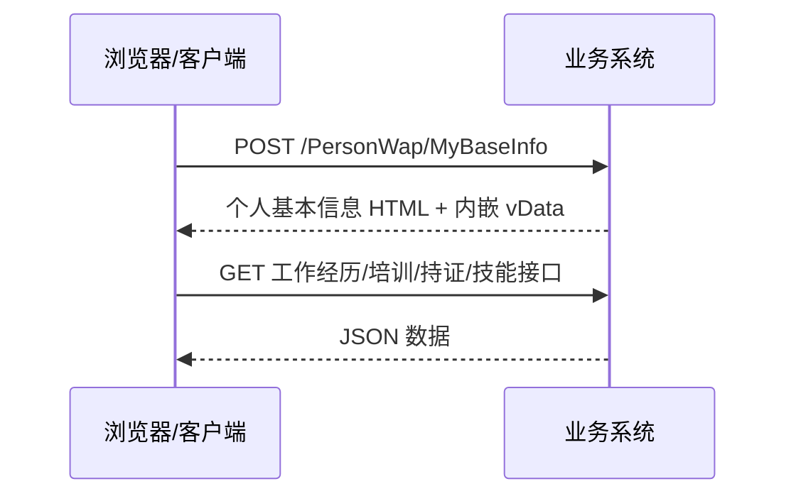

# 个人信息接口手册

## 文档信息

| 项目 | 内容 |
| --- | --- |
| 文档名称 | 个人信息接口手册 |
| 系统名称 | 陕西煤业-素质兴安-全员考试 |
| 系统地址 | `http://61.150.84.25:100` |
| 文档版本 | `v1.1` |
| 最后验证时间 | `2026-04-26` |
| 适用范围 | 手机应用、桌面应用、内部系统对接 |
| 文档状态 | 可用于开发对接 |

## 修订记录

| 版本 | 日期 | 说明 |
| --- | --- | --- |
| `v1.1` | `2026-04-26` | 明确 `MyBaseInfo` 虽然返回 HTML，但它承载真实基础资料与二维码路径，因此保留为正文数据载体接口 |
| `v1.0` | `2026-04-26` | 基于浏览器真实点击“姓名 -> 个人信息”后的抓包与前端逻辑分析整理 |

## 1. 文档目标

本文档用于说明系统“个人信息”模块的接口结构，目标是让后续客户端开发可以直接依据本文档完成以下工作：

1. 进入个人信息页面
2. 读取基本资料、二维码、工作经历、培训经历、持证信息、技能提升信息
3. 识别照片、身份证、毕业证等图片资源获取方式
4. 理解可写接口的参数结构与权限控制逻辑

## 2. 快速结论

通过真实点击右上角姓名再点击“个人信息”，当前模块真正与“个人信息”本体相关的加载链路如下：

1. `POST /PersonWap/MyBaseInfo`
2. 在 `MyBaseInfo` 返回的基础资料载体内，再根据页签触发不同数据接口

页签与接口对应关系：

| 页签 | 数据来源 |
| --- | --- |
| 基本信息 | `POST /PersonWap/MyBaseInfo` 返回的 HTML 内嵌数据 |
| 个人二维码 | `POST /PersonWap/MyBaseInfo` 返回的 HTML 内嵌图片路径 |
| 工作经历 | `GET /ArchiveManger/D_CurriculumVitae/GetPersonCurriculumVitaeOne` |
| 培训经历 | `GET /PersonWap/GetPersonTrainingMessageOne` |
| 持证信息 | `GET /PersonWap/GetCertificateOne` |
| 技能提升 | `GET /PersonWap/GetPersonWorkTypeOne` |

说明：

网页点击过程中会先经过公共导航请求，但它们属于“页面切换”范畴，不属于本手册的个人信息模块正文范围。

补充判断：

1. `MyBaseInfo` 虽然传输形态是 HTML，不是纯 JSON。
2. 但“基本信息”和“个人二维码”当前都依赖它返回的内嵌 `vData` 与图片路径。
3. 因此它不是可随意删除的页面壳，而是当前个人信息模块必须保留的数据载体接口。

## 3. 系统基础约定

### 3.1 基础地址

```text
http://61.150.84.25:100
```

### 3.2 协议与会话

| 项目 | 说明 |
| --- | --- |
| 传输协议 | `HTTP` |
| 会话保持 | `Cookie Session` |
| 主要会话 Cookie | `ASP.NET_SessionId` |
| 业务关键 Cookie | `xxpid` |

### 3.3 加载方式

个人信息模块不是通过页面 URL 直接跳转到一个新页面，而是：

1. 保持浏览器地址仍为 `http://61.150.84.25:100/PersonWap/Index#`
2. 通过 AJAX 加载 HTML 片段
3. 再在当前页面容器中局部替换内容

也就是说，客户端如果要自己实现，不必完全模拟这个 UI 加载过程，但要理解其接口依赖关系。

### 3.4 参数编码规则

该模块的参数风格不统一，需特别注意：

| 参数类型 | 是否 Esdt 编码 |
| --- | --- |
| `MyBaseInfo.pid` | `Esdt(pid)` |
| 工作经历/培训/持证/技能接口中的 `personId` | `Esdt(pid)` |
| 保存基本资料 `SaveElseInfoOne.pid` | 明文 |

开发建议：

1. 不要假设所有接口都使用同一种编码规则
2. 每个接口单独按文档处理参数

## 4. 模块请求流程



## 5. 接口清单

### 5.1 已真实点击验证的只读接口

| 序号 | 方法 | 路径 | 认证要求 | 说明 |
| --- | --- | --- | --- | --- |
| 1 | `POST` | `/PersonWap/MyBaseInfo` | 是 | 个人基础资料载体，返回 HTML 内嵌 `vData` |
| 2 | `GET` | `/ArchiveManger/D_CurriculumVitae/GetPersonCurriculumVitaeOne` | 是 | 获取工作经历 |
| 3 | `GET` | `/PersonWap/GetPersonTrainingMessageOne` | 是 | 获取培训经历 |
| 4 | `GET` | `/PersonWap/GetCertificateOne` | 是 | 获取持证信息 |
| 5 | `GET` | `/PersonWap/GetPersonWorkTypeOne` | 是 | 获取技能提升信息 |
| 6 | `GET` | `/ArchiveManger/D_PersonManager/GetPersonPhoto` | 是 | 获取头像图片 |

### 5.2 前端暴露但当前账号未执行写操作验证的接口

| 序号 | 方法 | 路径 | 说明 |
| --- | --- | --- | --- |
| 7 | `POST` | `/ArchiveManger/D_PersonManager/SaveElseInfoOne` | 保存联系方式和家庭地址 |
| 8 | `POST` | `/ArchiveManger/D_Person/AddPhoto` | 上传照片/身份证/毕业证 |
| 9 | `POST` | `/ArchiveManger/D_CurriculumVitae/DeleteOne` | 删除工作经历 |
| 10 | `POST` | `/PersonWap/MyEditCurriculumVitae` | 打开新增/编辑工作经历页面 |

说明：

当前登录账号的 `AllowChangeCurriculumVitae=false`，页面会隐藏上传和提交入口，因此上述写接口本次没有实际提交执行，只能依据前端函数逻辑分析。

## 6. 接口明细

### 6.1 加载个人基础资料载体

#### 基本信息

| 项目 | 内容 |
| --- | --- |
| 接口名称 | 加载个人基础资料载体 |
| 方法 | `POST` |
| 路径 | `/PersonWap/MyBaseInfo` |
| 是否需要登录 | 是 |
| 响应类型 | `text/html` |
| 验证状态 | 已真实点击验证 |

#### 请求参数

| 字段 | 类型 | 必填 | 示例 | 说明 |
| --- | --- | --- | --- | --- |
| `pid` | `string` | 是 | `Esdt(pid)` | 用户 `pid` 的编码值 |
| `sstype` | `string` | 是 | `0` | 初始页签，`0` 表示基本信息 |

#### 实际请求体特征

```text
pid=<Esdt(pid)>&sstype=0
```

#### 返回内容结构

该接口直接返回个人信息页面 HTML，核心部分包括：

1. 页签栏
   - 基本信息
   - 个人二维码
   - 工作经历
   - 培训经历
   - 持证信息
   - 技能提升
2. 基本信息表单
3. 二维码图片区
4. 内嵌 `vData` 对象

#### 内嵌 vData 字段

实测返回中包含：

| 字段 | 含义 |
| --- | --- |
| `pid` | 用户 `pid` |
| `sstype` | 当前初始页签 |
| `DepartmentId` | 部门 ID |
| `photo` | 用户照片相对路径 |
| `qrphoto` | 用户二维码相对路径 |
| `sfzphoto` | 身份证图片相对路径 |
| `byzphoto` | 毕业证图片相对路径，当前账号为空 |
| `pnum` | 工号 |
| `idcard` | 身份证号 |
| `pname` | 姓名 |
| `AllowChangeCurriculumVitae` | 是否允许修改 |
| `punit` | 工作单位 |
| `tel` | 联系方式 |
| `address` | 家庭地址 |

#### 重要结论

1. “基本信息”和“个人二维码”主要依赖这个 HTML 响应内嵌的数据
2. 不是单独再去请求一个 JSON 基本信息接口
3. 当前账号 `AllowChangeCurriculumVitae=false`

### 6.2 获取工作经历

#### 基本信息

| 项目 | 内容 |
| --- | --- |
| 接口名称 | 获取工作经历 |
| 方法 | `GET` |
| 路径 | `/ArchiveManger/D_CurriculumVitae/GetPersonCurriculumVitaeOne` |
| 是否需要登录 | 是 |
| 响应类型 | `application/json` |
| 验证状态 | 已真实点击“工作经历”页签验证 |

#### 请求参数

| 字段 | 类型 | 必填 | 说明 |
| --- | --- | --- | --- |
| `personId` | `string` | 是 | `Esdt(pid)` |
| `rows` | `number` | 是 | 分页大小，当前页面实测为 `10` |
| `page` | `number` | 是 | 页码，当前实测为 `1` |

#### 实测响应结构

```json
{
  "total": 1,
  "rows": [
    {
      "CurriculumVitaeId": "<guid>",
      "PersonId": "<guid>",
      "PersonName": "张*",
      "PersonIDNumber": "<idcard>",
      "PersonNumber": "<idcard>",
      "PersonDepartment": "<department>",
      "DepartmentId": "<guid>",
      "CurriculumVitaeType": "工作经历",
      "AllowChangeCurriculumVitae": false,
      "StartTime": "2023-08-20T15:49:57",
      "EndTime": "2019-01-01T00:00:00",
      "Company": "<unit>",
      "WorkType": ""
    }
  ]
}
```

> 2026-10-28：本样本中的姓名、身份证号、单位与 GUID 已替换为占位符（AGENTS.md §9.4）。

#### 主要字段

| 字段 | 说明 |
| --- | --- |
| `total` | 总记录数 |
| `rows[].CurriculumVitaeId` | 工作经历记录 ID |
| `rows[].Company` | 任职单位 |
| `rows[].WorkType` | 工种/岗位 |
| `rows[].StartTime` | 开始时间 |
| `rows[].EndTime` | 结束时间 |
| `rows[].AllowChangeCurriculumVitae` | 是否允许修改该经历 |

### 6.3 获取培训经历

#### 基本信息

| 项目 | 内容 |
| --- | --- |
| 接口名称 | 获取培训经历 |
| 方法 | `GET` |
| 路径 | `/PersonWap/GetPersonTrainingMessageOne` |
| 是否需要登录 | 是 |
| 响应类型 | `application/json` |
| 验证状态 | 已真实点击“培训经历”页签验证 |

#### 请求参数

| 字段 | 类型 | 必填 | 说明 |
| --- | --- | --- | --- |
| `personId` | `string` | 是 | `Esdt(pid)` |
| `rows` | `number` | 是 | 分页大小，当前实测为 `10` |
| `page` | `number` | 是 | 页码，当前实测为 `1` |

#### 实测响应

```json
{
  "total": 0,
  "rows": []
}
```

#### 前端展示逻辑

当 `rows` 为空时，页面显示：

```text
您没有培训记录！
```

#### 预期数据字段

根据前端渲染逻辑，若存在数据，至少会使用：

| 字段 | 用途 |
| --- | --- |
| `WorkTypeName` | 工种名称 |
| `TrainingProject` | 培训项目 |
| `TheoryScore` | 成绩 |
| `TrainingStartTime` | 开始时间 |
| `TrainingEndTime` | 结束时间 |

### 6.4 获取持证信息

#### 基本信息

| 项目 | 内容 |
| --- | --- |
| 接口名称 | 获取持证信息 |
| 方法 | `GET` |
| 路径 | `/PersonWap/GetCertificateOne` |
| 是否需要登录 | 是 |
| 响应类型 | `application/json` |
| 验证状态 | 已真实点击“持证信息”页签验证 |

#### 请求参数

| 字段 | 类型 | 必填 | 说明 |
| --- | --- | --- | --- |
| `personId` | `string` | 是 | `Esdt(pid)` |

#### 实测响应

```json
{
  "total": 0,
  "rows": []
}
```

#### 前端展示逻辑

当 `rows` 为空时，页面显示：

```text
您没有证书！
```

#### 预期数据字段

根据前端渲染逻辑，若存在数据，至少会使用：

| 字段 | 用途 |
| --- | --- |
| `WorkTypeName` | 工种名称 |
| `CertificateCategoryName` | 证书类别 |
| `CertificateNo` | 证书号 |
| `ReleaseDate` | 发证日期 |
| `LoseEndTime` | 有效期 |

### 6.5 获取技能提升信息

#### 基本信息

| 项目 | 内容 |
| --- | --- |
| 接口名称 | 获取技能提升信息 |
| 方法 | `GET` |
| 路径 | `/PersonWap/GetPersonWorkTypeOne` |
| 是否需要登录 | 是 |
| 响应类型 | `application/json` |
| 验证状态 | 已真实点击“技能提升”页签验证 |

#### 请求参数

| 字段 | 类型 | 必填 | 说明 |
| --- | --- | --- | --- |
| `personId` | `string` | 是 | `Esdt(pid)` |
| `type` | `number` | 是 | 当前前端固定传 `2` |

#### 实测响应

```json
{
  "total": 0,
  "rows": []
}
```

#### 前端展示逻辑

当 `rows` 为空时，页面显示：

```text
您没有技能提升经历！
```

#### 预期数据字段

根据前端渲染逻辑，若存在数据，至少会使用：

| 字段 | 用途 |
| --- | --- |
| `PersonWorkTypeId` | 技能提升记录 ID |
| `WorkTypeName2` | 工种名称 |
| `CertificateNo` | 证书号 |
| `PassTime` | 通过时间 |
| `AppraisalUnit` | 发证单位 |

### 6.6 获取头像图片

#### 基本信息

| 项目 | 内容 |
| --- | --- |
| 接口名称 | 获取头像图片 |
| 方法 | `GET` |
| 路径 | `/ArchiveManger/D_PersonManager/GetPersonPhoto` |
| 是否需要登录 | 是 |
| 响应类型 | 图片流 |
| 验证状态 | 已通过页面图片 URL 验证 |

#### 请求参数

| 字段 | 类型 | 必填 | 说明 |
| --- | --- | --- | --- |
| `did` | `string` | 是 | `Esdt(DepartmentId)` |
| `pid` | `string` | 是 | `Esdt(PersonId)` |

#### 实测 URL 形态

```text
/ArchiveManger/D_PersonManager/GetPersonPhoto?did=<Esdt(DepartmentId)>&pid=<Esdt(PersonId)>
```

## 7. 图片资源规则

个人信息模块中的图片来源并不统一。

### 7.1 用户头像

通过接口获取：

```text
/ArchiveManger/D_PersonManager/GetPersonPhoto?did=<Esdt(DepartmentId)>&pid=<Esdt(PersonId)>
```

### 7.2 个人二维码

不走单独 JSON/XHR 接口，而是由 `MyBaseInfo` 的 `vData.qrphoto` 拼接成静态资源路径：

```text
http://61.150.84.25:100/qyksFiles/person/<DepartmentId>/<pid>_QR.jpg
```

### 7.3 身份证图片

同样来自 `vData.sfzphoto`：

```text
http://61.150.84.25:100/qyksFiles/person/<DepartmentId>/SFZ<pid>.sfz
```

### 7.4 毕业证图片

来自 `vData.byzphoto`。当前账号该字段为空，所以实际图片 URL 退化为站点根地址加随机参数，客户端实现时要额外判断空值。

开发建议：

1. 先判断 `vData.byzphoto` 是否为空
2. 为空时不要直接拼接成请求 URL

## 8. 可写接口分析

### 8.1 保存基本资料

#### 验证状态

前端暴露，当前账号无权限，未实际提交执行。

#### 前端函数逻辑

页面 `onSavePersonInfo()` 调用：

```text
POST /ArchiveManger/D_PersonManager/SaveElseInfoOne
```

#### 请求参数

| 字段 | 类型 | 说明 |
| --- | --- | --- |
| `pid` | `string` | 明文 `M_PersonId` |
| `Link` | `string` | 联系方式 |
| `Address` | `string` | 家庭地址 |

#### 权限控制

若 `AllowChangeCurriculumVitae=false`，前端先拦截并提示：

```text
您没有修改权限！
```

### 8.2 上传照片/身份证/毕业证

#### 验证状态

前端暴露，当前账号无权限，未实际上传执行。

#### 接口信息

```text
POST /ArchiveManger/D_Person/AddPhoto
```

#### 提交方式

`multipart/form-data`

#### FormData 字段

| 字段 | 说明 |
| --- | --- |
| `personPhoto` | `type=1` 时上传的头像文件 |
| `personSFZ` | `type=2` 时上传的身份证文件 |
| `personBYZ` | `type=3` 时上传的毕业证文件 |
| `PersonId` | 明文 `l_PersonId` |
| `type` | `1` 头像，`2` 身份证，`3` 毕业证 |

#### 返回处理

前端会把返回里的 `result.message` 当作图片路径，并立即刷新对应图片。

### 8.3 删除工作经历

#### 验证状态

前端暴露，当前账号无权限，未实际执行删除。

#### 接口信息

```text
POST /ArchiveManger/D_CurriculumVitae/DeleteOne
```

#### 请求参数

| 字段 | 说明 |
| --- | --- |
| `ids` | `Esdt(CurriculumVitaeId)` |
| `userId` | 空字符串 |
| `moduleId` | 空字符串 |
| `ip` | `Esdt('')` |

#### 删除成功后的前端行为

前端会重新加载：

```text
POST /PersonWap/MyBaseInfo
```

参数：

```text
pid=Esdt(M_PersonId)&sstype=1
```

### 8.4 打开新增/编辑工作经历页

#### 验证状态

前端暴露，当前账号无权限，未实际通过界面操作进入。

#### 入口逻辑

新增：

```text
POST /PersonWap/MyEditCurriculumVitae
```

参数：

```text
pid=<明文pid>&id=
```

编辑：

```text
POST /PersonWap/MyEditCurriculumVitae
```

参数：

```text
pid=<明文pid>&id=<CurriculumVitaeId>
```

## 9. 权限控制结论

个人信息模块里存在前端级权限控制，关键字段为：

```text
AllowChangeCurriculumVitae
```

当前账号实测值：

```text
false
```

对应表现：

1. 隐藏提交按钮
2. 隐藏上传入口
3. 执行保存/上传时会先弹出“您没有修改权限！”

开发建议：

1. 客户端不要只依赖按钮显示与否判断权限
2. 如果未来调用写接口，仍应处理服务端权限失败响应

## 10. 页面字段与 UI 映射

### 10.1 基本信息区

| 页面字段 | 数据来源 |
| --- | --- |
| 工号 | `vData.pnum` |
| 姓名 | `vData.pname` |
| 身份证号 | `vData.idcard` |
| 工作单位 | `vData.punit` |
| 联系方式 | `vData.tel` |
| 家庭地址 | `vData.address` |

### 10.2 页签索引

| `sstype / data-index` | 含义 |
| --- | --- |
| `0` | 基本信息 |
| `1` | 工作经历 |
| `2` | 培训经历 |
| `3` | 持证信息 |
| `4` | 技能提升 |
| `5` | 个人二维码 |

## 11. 客户端实现建议

### 11.1 推荐实现方式

客户端不需要完全模拟网页的 AJAX 局部加载过程，可以按功能直接对接：

1. 已登录后获取个人信息页
2. 解析或映射 `MyBaseInfo` 的基础字段
3. 按页签需求调用对应 JSON 接口
4. 图片资源按不同来源分别处理

### 11.2 推荐封装结构

建议按下面三层封装：

1. `getPersonalBaseInfo()`
   - 对应 `POST /PersonWap/MyBaseInfo`
2. `getPersonalTabData(type)`
   - 映射工作经历、培训、持证、技能接口
3. `savePersonalInfo()/uploadPersonalAsset()`
   - 对应可写接口

### 11.3 特别注意

1. 不是所有接口都用明文 `pid`
2. 不是所有图片都来自同一个接口
3. 当前模块混合使用：
   - HTML 片段
   - JSON 接口
   - 直接图片资源 URL

## 12. 联调验收清单

建议至少验证以下项目：

1. 能从已登录状态进入个人中心
2. 能正确加载 `MyBaseInfo`
3. 能正确读取 `vData` 中的基础字段
4. 能正确拉取工作经历
5. 培训/持证/技能为空时能正确展示空状态
6. 头像、二维码、身份证图片能正确加载
7. `byzphoto` 为空时客户端不会错误发起无效请求
8. 写接口在无权限时客户端能正确处理

## 13. 当前结论

截至 `2026-04-26`，个人信息模块的核心事实如下：

1. 个人信息主体通过 `MyBaseInfo` 的 HTML 片段加载
2. 基础资料不是单独 JSON 接口，而是内嵌在 HTML 的 `vData` 中
3. 工作经历、培训经历、持证信息、技能提升分别使用独立 JSON 接口
4. 图片资源存在接口型和静态路径型两种来源
5. 当前账号无修改权限，写接口需要单独做权限适配

## 14. 后续可继续补充的文档

建议下一步继续沿用相同模板补以下文档：

1. 题库选择接口手册
2. 模拟考试接口手册
3. 安排考试接口手册
4. 成绩排名接口手册
